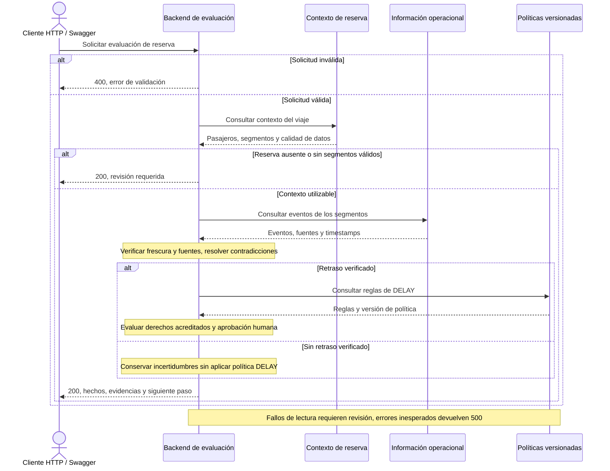

# Evaluación de una interrupción: flujo e integraciones

El diagrama muestra integraciones lógicas y el orden real de las lecturas, sin detallar clases, adaptadores ni archivos. Actualmente las tres integraciones se simulan mediante JSON locales. Un fallo conserva los hechos ya verificados y evita prometer beneficios. La revisión indica contacto humano, sin crear casos ni modificar reservas.

El endpoint demo permite seleccionar fixtures y ejecuta este mismo flujo. No reproduce respuestas pregrabadas. Las responsabilidades técnicas de puertos y adaptadores permanecen en el [diagrama de arquitectura](hexagonal-architecture.md).
