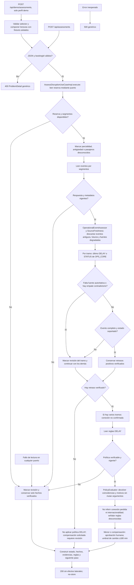

# Procesamiento de la consulta

La decisión de cada tramo se repite para todos los segmentos. Un fallo de política conserva el retraso ya verificado; un fallo anterior no inventa hechos. La indisponibilidad de fuente se representa con revisión, no como ausencia de interrupción.

El selector de fixtures demo solo modifica las respuestas de las integraciones simuladas. Ambos endpoints ejecutan el mismo caso de uso. Escenarios de política externos distintos de `DisruptionScenario.DELAY` no se consideran verificados.
