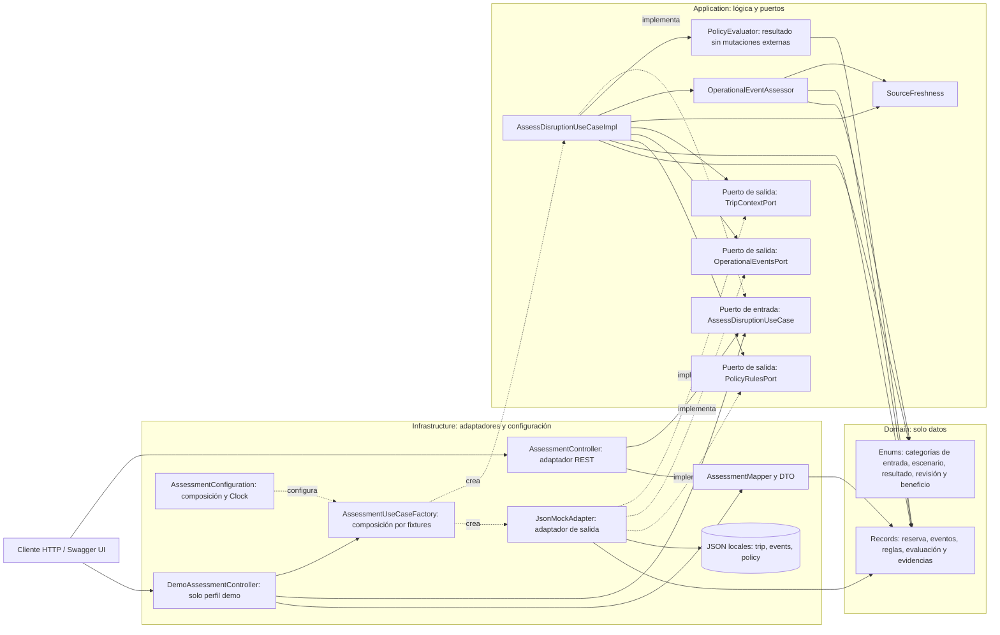

# Arquitectura hexagonal implementada

Las flechas continuas representan uso; las discontinuas, implementación o composición. Las lecturas se despachan por interfaces al adaptador. Domain no depende de ninguna otra capa; Application no importa Spring ni Infrastructure. Un único adaptador implementa los tres puertos, con archivos separados por contrato. No hay herramientas de escritura ni modelos de IA.

Lombok genera constructores en compilación; no es un componente de runtime. springdoc genera OpenAPI y sirve Swagger UI en infraestructura. El puerto de entrada expone únicamente `execute`; los servicios auxiliares conservan toda decisión de negocio dentro de Application.

El endpoint demo selecciona conjuntos de fixtures sin estado compartido y llama al mismo puerto de entrada. `DemoOpenApiConfiguration`, también restringido a demo, añade ejemplos documentales desde el catálogo y las respuestas verificadas. No decide derechos ni sustituye la evaluación por un snapshot.
