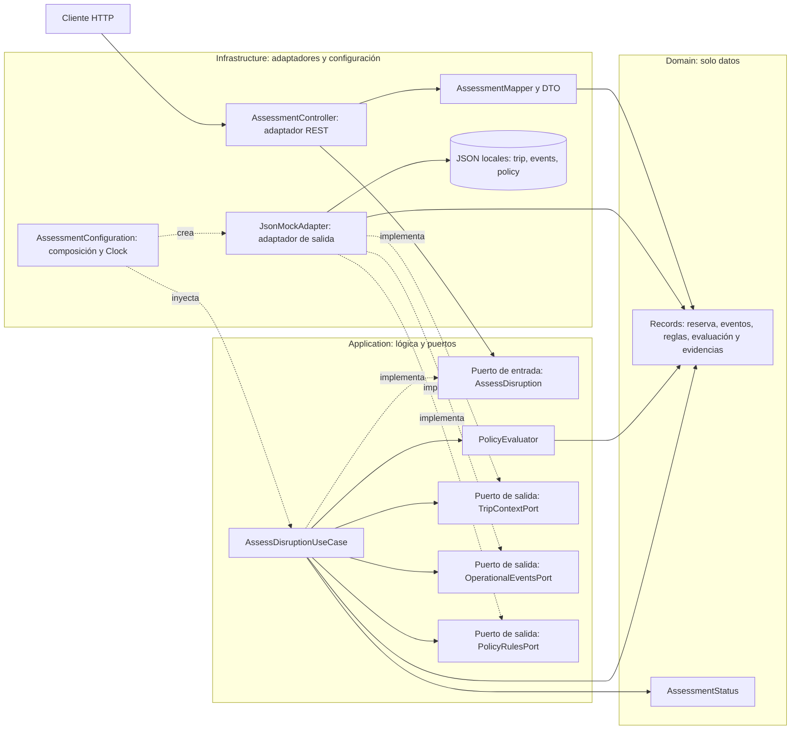

# Arquitectura hexagonal implementada

Las flechas continuas representan uso; las discontinuas, implementación o composición. Las lecturas se despachan por interfaces al adaptador. Domain no depende de ninguna otra capa; Application no importa Spring ni Infrastructure. Un único adaptador implementa los tres puertos, con archivos separados por contrato. No hay herramientas de escritura ni modelos de IA.
